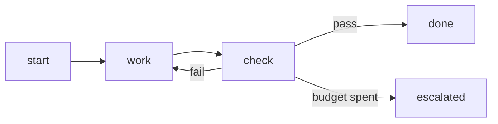

# Loop graph builder

Turn a task into a small, reviewable loop contract in `docs/loops/<name>.md` that a human can read
without running anything, and that `python3 tools/skills/validate.py` can check.

Based on the loop-graph guide (Bruniaux, claude-code-ultimate-guide, `loop-graph-engineering.md`) and the
working principles below. Worked example from this project: `docs/loops/agent-round.md`.

## Principles (Karpathy-style, applied)
1. **Think before building.** State the goal, the assumptions and the open questions first. If a
   decision is the owner's (license, store, real game data, anything irreversible), make it an
   `escalated` exit, not a guess.
2. **Smallest structure that works.** One bounded task with local tool feedback is a plain loop. Use a
   graph only when you need explicit routing, joins, parallel branches, interruption or durable resume.
   Do not build a multi-agent graph because it is easy.
3. **Surgical.** The loop touches only the files its nodes own. Name the owner of every shared file.
4. **Goal-driven.** Every loop has a verifiable success test (a command with an expected result).
   A model saying "done" is an observation, not acceptance evidence.

## Procedure
1. Write the one-sentence goal and the success command. If you cannot name a command, the goal is not
   ready: split it or add a human review node.
2. Choose the structure: plain loop or graph (justify in one line, at the top of the doc).
3. Fill the seven contract sections, in this order (the validator requires these headings):
   Goal and input, State, Actions, Observation, Verification, Stop and escalation, Evidence.
4. Add a `## Budget` section with one `- budget <name>: <integer>` line per limit. Every retry cycle
   needs one (rework count, minutes, usage percent). A requested limit is not a budget; the controller
   must count it. Count recovery attempts against the budget.
5. Draw the graph in a ```mermaid block (`flowchart LR`, edges as `a --> b` or `a -->|label| b`).
   Terminals are named `done`, `failed`, `escalated` and have no exits. Every other node has an exit,
   is reachable from the first node, and can reach a terminal.
6. Separate the maker from the acceptor: the node that produces work never accepts it. Acceptance is
   a deterministic check, an independent review, or a named human.
7. Define checkpoints: what is persisted, by whom, where (files in git, not chat history), and what
   happens if a node reruns after a resume. Prefer idempotent steps; keep a stable ID per external effect.
8. Run `python3 tools/skills/validate.py`; fix every problem. Then dry-run the graph by hand once:
   walk each terminal from the start and say which evidence proves it.

## Contract template
```
# Loop: <name>
Structure: <plain loop | graph>, because <one line>.
## Goal and input
## State            (what persists, who may write it)
## Actions          (allowed, and explicitly not allowed)
## Observation      (what feeds the next iteration)
## Verification     (the command(s) and expected result; who accepts)
## Stop and escalation   (done / failed / escalated, and who decides)
## Evidence         (SHAs, outputs, versions that prove the claim)
## Budget
- budget <name>: <int>

```

## Rules that came from real failures here
- Verify in a clean copy built from the repository HEAD plus only the producer's files. A copy of the
  working tree contaminates the check with other agents' unfinished files.
- Agents in parallel work in private copies and own disjoint files; the lead is the only writer of
  shared files (indexes, wiring, handoff).
- Never commit unverified work to quiet a "uncommitted changes" hook. Wait for the verification.
- Put usage thresholds in the budget as enforced numbers (here 95 wrap up, 98 save) and write the
  handoff file before the last one.
- Mutation-check any new test: break the code once on purpose and see the test fail. If it survives,
  prove it is an equivalent mutant or add a test.

## Anti-patterns (from the guide)
"Keep trying until done"; a diagram with no executable meaning; dynamic topology with no policy;
one agent creating and accepting; checkpoints with no idempotency; token-only observability.
