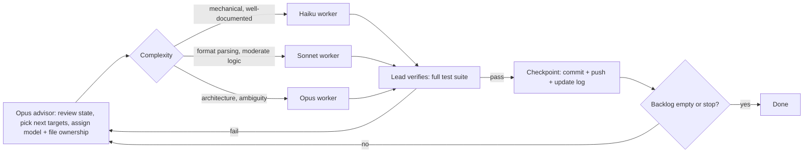

# heroes-mobile

Clean-room, data-driven reimplementation tooling inspired by Heroes of Might and
Magic 3: readers for its file formats, a deterministic battle core, and a text
simulator to run battles from JSON scenarios.

The tools read the user's own legally owned game files at runtime. No original
assets or code are committed to this repository. This project is not affiliated
with or endorsed by the rights holders of Heroes of Might and Magic 3.

## Features

| Area | Item | Notes |
|------|------|-------|
| Formats | LOD archives (`lod-list`, `lod-extract`) | read-only, lazy member access |
| Formats | DEF sprites (`def-to-png`) | hardened against malformed input |
| Formats | H3M maps (`h3m-info`) | header through terrain; objects not yet parsed |
| Formats | PCX images, TXT tables | readers |
| Engines | Battle core (`h3re.battle`) | hex grid, turn queue, morale and luck, deterministic replay |
| Engines | Adventure core (`h3re.adventure`) | movement and economy |
| Engines | Greedy battle AI (`h3re.battle_ai`) | used by `battle-sim --chooser ai` |
| Engines | PCG32 RNG (`h3re.rng`) | named streams, same seed gives same output |
| Tools | `battle-sim` | runs a JSON scenario, text board with `--pretty` |
| Tools | Determinism gate | soak runs, replay bisector, banned-API lint |

Specs for each area are in [`docs/specs/`](docs/specs/). Every format is verified
only against synthetic fixtures so far; none has been checked against real game files.

## Quick start

Requires Python 3.13. Run everything from the repository root unless noted.

```sh
# Run the full test suite
python3 -m unittest discover -s tools/h3re/tests

# Simulate a battle with a readable report (board, event log, summary)
cd tools/h3re && python3 -m h3re battle-sim SCENARIO.json --seed 12345 --chooser scripted --pretty

# Same battle, with a board every 5 steps
cd tools/h3re && python3 -m h3re battle-sim SCENARIO.json --seed 12345 --chooser scripted --pretty --board-every 5

# Read a LOD archive (your own game files)
cd tools/h3re && python3 -m h3re lod-list FILE.LOD
```

`battle-sim` takes a JSON scenario. The format is described in
[`docs/specs/battle-scenario.md`](docs/specs/battle-scenario.md). Its section 8
explains the `--pretty` report: a hex board, an aligned event log and a summary.

## Project laws

[`CLAUDE.md`](CLAUDE.md) is the project constitution. It sets out the clean-room
rule, the determinism rules (integer-only simulation, no clocks, no I/O in the
simulation modules), the golden re-pin rule, and the rule that tests must pass
before any commit.

## Development loop

The advisor loop that plans and verifies work on this repository, from
[`docs/checkpoints/GRAPH.md`](docs/checkpoints/GRAPH.md):



Progress is logged in [`docs/checkpoints/GRAPH.md`](docs/checkpoints/GRAPH.md) and
[`docs/checkpoints/HANDOFF.md`](docs/checkpoints/HANDOFF.md).

## Repository layout

- `tools/h3re/` - Python package: readers, rules, battle and adventure cores, CLI.
- `tools/h3re/tests/` - unit tests on synthetic fixtures (no game files needed).
- `docs/specs/` - format and design specs, written from public documentation and observed mechanics.
- `docs/checkpoints/` - reverse-engineering workflow graph and handoff notes.
- `.github/workflows/test.yml` - CI running the test suite on push and pull request.
