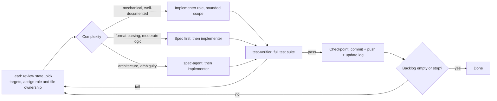

# heroes-mobile

Clean-room, data-driven reimplementation tooling inspired by Heroes of Might and
Magic 3: readers for its file formats, deterministic battle, adventure, town,
hero and encounter cores in Python (the reference), and an Android app with a
Kotlin engine that the Python reference checks.

The tools read the user's own legally owned game files at runtime. No original
assets or code are committed to this repository. This project is not affiliated
with or endorsed by the rights holders of Heroes of Might and Magic 3.

## Status

Checkpoint 46 is the latest. The Python reference covers the readers, the
simulation cores, the replay format and the presenter. The Kotlin `:sim`
module has its foundation (canonical JSON, SHA-256, PCG32, named streams) and
is the next port (see [`docs/checkpoints/HANDOFF.md`](docs/checkpoints/HANDOFF.md)).
The direction is recorded in [ADR-0004](docs/adr/ADR-0004-android-kotlin-core-python-oracle.md):
a native Android app with a Kotlin engine, and the Python code as the oracle.

## Features

| Area | Item | Notes |
|------|------|-------|
| Formats | LOD archives (`lod-list`, `lod-extract`) | read-only, lazy member access |
| Formats | DEF sprites (`def-to-png`) | hardened against malformed input |
| Formats | H3M maps (`h3m-info`) | header, terrain; object templates, instances and events with `objects=True`; an unsupported object body fails with its index and offset |
| Formats | PCX images, TXT tables | readers |
| Content | Creature TXT loader (`h3re.content`) | column mapping not yet verified; ability table is a placeholder |
| Data | Data packs (`data/*.json`, `h3re.datapack`) | strict loader; `rules.json` and `battle_policy.json` are read at import |
| Engines | Battle core (`h3re.battle`) | hex grid, turn queue, morale and luck; rules-pack hash in the state |
| Engines | Battle presenter (`h3re.present`) | read-only, versioned, RNG-free view-model for the mobile UI |
| Engines | Adventure core (`h3re.adventure`) | movement, economy, and `Attack` on guards and heroes |
| Engines | Encounters (`h3re.encounter`) | a map battle on its own stream; survivors return to the army |
| Engines | Town core (`h3re.town`) | building rules, weekly growth; pack content is in the state |
| Engines | Hero core (`h3re.hero`) | experience, level-ups with seeded draws |
| Engines | Greedy battle AI (`h3re.battle_ai`) | used by `battle-sim --chooser ai` |
| Engines | PCG32 RNG (`h3re.rng`) | named streams, same seed gives same output |
| Replay | Replay files (`h3re.replay`, `replay record/verify/info`) | versioned, canonical, pack-hash checked |
| Conformance | Vectors (`h3re.vectors`) | exported from Python for the Kotlin tests; `--check` detects stale files |
| Android | Kotlin `:sim` foundation (`android/sim`) | canonical JSON, SHA-256, PCG32, streams; no Android dependency |
| Tools | `battle-sim` | runs a JSON scenario, text board with `--pretty` |
| Tools | Determinism gate | soak runs, replay bisector, banned-API lint |

Specs for each area are in [`docs/specs/`](docs/specs/). Every format is verified
only against synthetic fixtures so far; none has been checked against real game files.

## Quick start

Requires Python 3.13. Run everything from the repository root unless noted.

```sh
# Run the full test suite
python3 -m unittest discover -s tools/h3re/tests

# Simulate a battle with a readable report (board, event log, summary)
cd tools/h3re && python3 -m h3re battle-sim SCENARIO.json --seed 12345 --chooser scripted --pretty

# Same battle, with a board every 5 steps
cd tools/h3re && python3 -m h3re battle-sim SCENARIO.json --seed 12345 --chooser scripted --pretty --board-every 5

# Read a LOD archive (your own game files)
cd tools/h3re && python3 -m h3re lod-list FILE.LOD

# Check that the exported Kotlin conformance vectors match the Python reference
cd tools/h3re && python3 -m h3re.vectors --check
```

`battle-sim` takes a JSON scenario. The format is described in
[`docs/specs/battle-scenario.md`](docs/specs/battle-scenario.md). Its section 8
explains the `--pretty` report: a hex board, an aligned event log and a summary.

## Project laws

[`CLAUDE.md`](CLAUDE.md) is the project constitution. It sets out the licensing and
provenance rule, the determinism rules (integer-only simulation, no clocks, no I/O in the
simulation modules), the golden re-pin rule, and the rule that tests must pass
before any commit.

## Development loop

The loop that plans and verifies work on this repository, from
[`docs/checkpoints/GRAPH.md`](docs/checkpoints/GRAPH.md). Each step is a role
(see `CLAUDE.md`), not a model:



Progress is logged in [`docs/checkpoints/GRAPH.md`](docs/checkpoints/GRAPH.md) and
[`docs/checkpoints/HANDOFF.md`](docs/checkpoints/HANDOFF.md).

## Repository layout

- `tools/h3re/` - Python package: readers, rules, battle, adventure, encounter, town and hero cores, replay, presenter, CLI.
- `tools/h3re/tests/` - unit tests on synthetic fixtures (no game files needed).
- `data/` - JSON data packs (rules, battle policy, synthetic test packs); no original game data.
- `android/` - Android app: Gradle build, `sim` (Kotlin engine, no Android dependency), `app`.
- `docs/specs/` - format and design specs, written from public documentation and observed mechanics.
- `docs/adr/` - architecture decisions.
- `docs/checkpoints/` - workflow graph and handoff notes.
- `.github/workflows/test.yml` - CI running the test suite on push and pull request.

## License

GPL-2.0-or-later (see [`LICENSE`](LICENSE) and `docs/adr/ADR-0010-license-gpl-2-or-later.md`).
The license covers the code and docs of this repository only. Original game files, art and
sound are never included; the app reads the player's own legally owned install. This project
is not affiliated with the rights holders of Heroes of Might and Magic.
