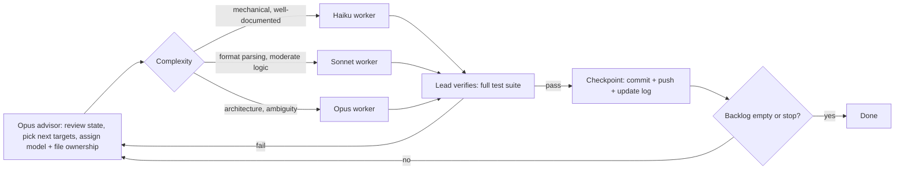

# Reverse-engineering loop graph

Clean-room rules: no original game assets or code are committed. Tools read the
user's own legally owned game files at runtime. Specs are written from public
documentation of the formats and observable game mechanics.

## Checkpoint log
| # | Checkpoint | Agent | Status |
|---|-----------|-------|--------|
| 0 | Repo scaffold + graph | lead | done |
| 1 | LOD archive reader | Haiku (stride fixed by lead) | done |
| 2 | DEF sprite + H3M map parsers | Sonnet | done (H3M stops after teams; unverified vs real files) |
| 3 | Combat/economy rules spec + engine design | Opus | done (uncertain items listed in rules.md, 12 experiments to verify) |
| 4 | CI workflow + README | Haiku | done |
| 5 | H3M sections after teams | Sonnet | done (layouts unverified; ban-bit semantics assumed) |
| 6 | CLI (lod-list, lod-extract, def-to-png, h3m-info) | Haiku | done |
| 7 | H3M truncated/trailing gzip rejection | Sonnet | done |
| 8 | Generic TXT reader | Sonnet | done |
| 9 | Doc consistency + empty-stack fix | Haiku | done |
| 10 | PCX reader | Haiku | done |
| 11 | PCG32 RNG + named streams | Sonnet | done (range half-open; engine-design says inclusive, to reconcile) |
| 12 | DEF hardening | Sonnet | done (palette 0-9 vs 0-7 still unreconciled with engine-design) |
| R2 | Round 2 Opus advisor | Opus | done |
| 13 | Doc reconciliation (RNG API, palette, README) | Haiku | done |
| 14 | Package exports | Haiku | done |
| 15 | Real-file tests gated on H3_DATA_DIR | Sonnet | done (never run on real data) |
| 16 | H3M terrain tiles | Sonnet | done (layout unverified) |
| 17 | Battle core, no spells | Opus | done (11 uncertain policies, golden hash pinned) |
| R3 | Round 3 Opus advisor | Opus | done |
| 18 | Greedy battle AI | Sonnet | done (50/50 vs random) |
| 19 | Battle hardening + docs | Sonnet | done |
| 20 | VCMI format cross-check report | Sonnet | done |
| 21 | battle-sim text simulator | Haiku | done |
| 22 | Adventure movement/economy core | Opus | done |
| 23 | VCMI rules cross-check report | Opus | done |
| 24 | H3M fixes (victory type 10, 144 artifacts, Chronicles) | Sonnet | done |
| 25 | DEF fixes (palette 0-7, legacy fmt 1, fmt 2/3) | Sonnet | done |
| 26 | TXT fixes (quoting, CRLF, encoding) | Sonnet | done |
| 27 | PCX palette + LOD duplicates | Haiku | done |
| 28 | Adventure rules per VCMI (golden re-pinned) | Sonnet | done |
| 29 | Battle rules per VCMI (golden re-pinned) | Opus | done |
| 30 | JSON data pack + strict loader | Sonnet | done (rules.py does not read it yet) |
| 31 | CLAUDE.md, role files, ADRs 0001-0003 | Haiku | done |
| 32 | Determinism gate: soak, bisector, banned-API lint, CI job | Sonnet | done |
| 33 | Single damage pipeline (RollPolicy) | Opus | done (golden hash unchanged) |
| 34 | rules.py constants load from data/rules.json | Sonnet | done (import opens only rules.json) |
| 35 | battle-sim --pretty, README landing page | Haiku | done (CLI wiring by lead) |
