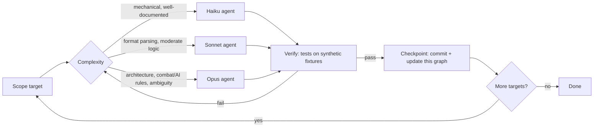

# Reverse-engineering loop graph

Clean-room rules: no original game assets or code are committed. Tools read the
user's own legally owned game files at runtime. Specs are written from public
documentation of the formats and observable game mechanics.

## Checkpoint log
| # | Checkpoint | Agent | Status |
|---|-----------|-------|--------|
| 0 | Repo scaffold + graph | lead | done |
| 1 | LOD archive reader | Haiku (stride fixed by lead) | done |
| 2 | DEF sprite + H3M map parsers | Sonnet | done (H3M stops after teams; unverified vs real files) |
| 3 | Combat/economy rules spec + engine design | Opus | done (uncertain items listed in rules.md, 12 experiments to verify) |
