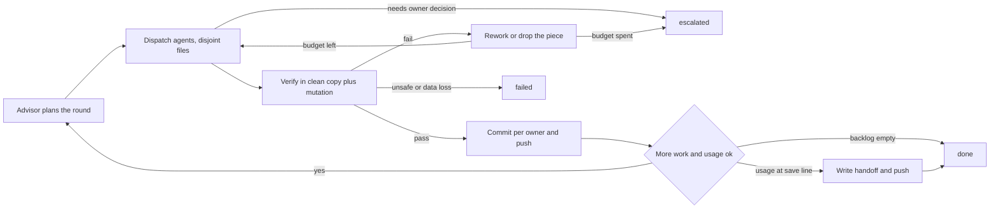

# Loop: one agent round (advise, fan out, verify, checkpoint)

Status: in use since checkpoint 5. Built from what this project learned; follows
`.claude/skills/loop-graph-builder`. Structure choice: an explicit graph, because the round has
parallel branches, a join (verification) and durable resume (the handoff file). A single agent
loop would not make those visible.

## Goal and input
Land the next backlog items as verified, committed, pushed pieces. Input: `docs/checkpoints/HANDOFF.md`
(Next list), the PR branch HEAD, the user's current plan-usage figure. Output: new commits, an updated
checkpoint log and handoff. Success is defined by the Verification section, never by an agent's report.

## State
Durable outside the context window, written only by the lead (the orchestrating session):
- git history on the PR branch (the source of truth for what is done)
- `docs/checkpoints/GRAPH.md` (one row per checkpoint) and `docs/checkpoints/HANDOFF.md` (resume point)
- `docs/memory/` (lessons and environment facts that outlive a round)
- usage figure: owner-reported, lives in the conversation and in `HANDOFF.md` when saving

## Actions
Allowed: read the repo, spawn advisor and worker agents with disjoint file ownership, run tests and
builds in private copies, commit and push to the PR branch. Not allowed without the owner: merge the PR,
push to `main`, publish releases, change the license, add secrets, spend past the usage lines.

## Observation
Agent reports (claims), exit codes and test counts from the lead's own runs, vector drift checks, CI
results on the PR, mutation-check outcomes.

## Verification
A piece is accepted only when the lead has, in a clean copy made from `git archive HEAD` plus only that
agent's owned files: run the full Python suite, the lint, `python3 -m h3re.vectors --check` and the
Kotlin tests, and seen at least one deliberate mutation of the new code fail a test. An agent's own
report is an observation, not acceptance evidence. Golden hashes must not move unless a recorded re-pin.

## Stop and escalation
- done: backlog empty, or usage reached the save line and the handoff is written and pushed
- failed: verification shows data loss or an unsafe change that cannot be isolated
- escalated: a decision only the owner can make (license, store, real game data, rule experiments),
  or the rework budget is spent

## Evidence
Commit SHAs, test counts, `vectors --check` output, lint output, mutation results, the PR check runs.
Never "the agent said it passed".

## Budget
Enforced by the lead, not requested of the agents:
- budget rework_per_piece: 2
- budget usage_wrap_up_percent: 95
- budget usage_save_percent: 98
- budget agent_minutes_per_round: 25

## Notes learned the hard way
- Build clean copies from `git archive HEAD` only. Copying the working tree pulls in other agents'
  unfinished files and produces false failures.
- One writer per shared file (vector wiring, conformance docs, handoff): agents write their own files,
  the lead wires and merges.
- The hook that complains about uncommitted files fires while agents are mid-work. That is expected;
  do not commit unverified work to silence it.
