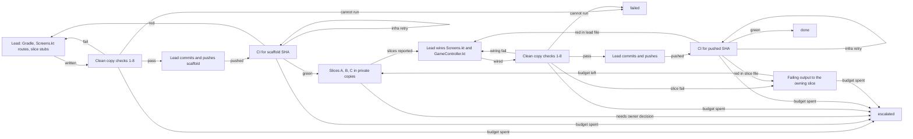

# Loop: app screens (Compose screens for `:app` on the merged `:presenter` ui logic)

Structure: graph, because three producers work disjoint slices in parallel and join at one wiring
step, and the only compile check for `:app` is remote CI, so local and CI gates are separate nodes.

## Goal and input
Build the Compose screens of the Android app on the already-merged pure logic in
`android/presenter/src/main/kotlin/h3/presenter/ui` (MenuModel, SetupForm, BattleLog, StackRoster,
BoardFit, ResultSummary, SaveSlots) and the app shell in `android/app/src/main/kotlin/h3/app`, and land
them as pushed commits that CI builds into an APK. Input: the branch HEAD, the advisor brief, the
owner-reported usage figure. Success is the Verification section for one SHA, never a producer's report.
Screens look and feel are NOT accepted here; the owner's device smoke test is a follow-up.

## State
File ownership (paths under `android/app/src/main/kotlin/h3/app/` unless written in full):
- Slice A, menus: `MenuScreens.kt` (Home, Setup, About; uses MenuModel and SetupForm).
- Slice B, battle: `BoardView.kt`, `BattleScreen.kt` (hex board; sprite from SpriteAtlas when the user's
  data is present, else a drawn token with a letter; count badge; active-stack outline; roster panel;
  log panel; uses BattleLog, StackRoster, BoardFit).
- Slice C, result and saves: `ResultScreen.kt`, `SaveFiles.kt`, `SaveScreen.kt` (result summary;
  autosave, manual save, slot list, load an exact chosen save; a ByteSink on `filesDir` that writes a temp
  file, syncs and renames, on its own writer thread; no import, export or file picker).
- Lead only: `MainActivity.kt`, `GameController.kt`, `Screens.kt`, `Engine.kt`, `Presets.kt`,
  `android/app/src/main/AndroidManifest.xml`, every Gradle file, `.github/workflows/`, `docs/specs/`,
  `docs/checkpoints/`, the trace, every commit and push. The scaffold writes stubs of the slice files with
  frozen signatures; from `commit_scaffold` on, each stub belongs to its slice. A signature change is a
  report to the lead, who makes it in `wire`.
- Trace: the lead is its only writer and transcribes each actor's record. While the run is open it lives
  in `docs/checkpoints/app-screens.trace.jsonl`; at a terminal the lead moves it to
  `docs/loops/runs/app-screens.<run>.jsonl` in the next commit (an open trace there fails validate.py).
- Counters live in the trace (`spent`): `ci_rounds` (pushes), `ci_infra_retries`, `ci_wait_minutes` and
  `producer_minutes` (each the longest so far, so they never go down), `scaffold_fixes`, `wire_fixes`,
  `rework`, the usage percent. On a save they are copied to `docs/checkpoints/HANDOFF.md`.
- Resume: git holds the pushed SHAs; verify steps always start from a fresh clean copy; a producer rerun
  rewrites only its own files. Each push has a stable ID, the tree fingerprint F (Verification): before
  committing, the lead looks for a branch commit with fingerprint F and reuses it instead of committing.

## Actions
Allowed: slices write their own files in private copies of `git archive <scaffold SHA>` and run the
`:presenter` tests; the lead writes the scaffold and the wiring, commits and pushes; test-verifier runs
the checks and reads CI through the GitHub MCP actions tools.
Pushes go only to the working branch or one named feature branch (e.g. `feature/app-screens`), and every
pushed commit is mergeable as-is: no throwaway CI branches, no WIP commits; a red CI is fixed forward with
a new commit on the same branch.
Not allowed (anyone): commit original game files or assets (sprites come from the user's own files at
runtime through SpriteAtlas, or a `copyH3Data` input outside the repo); logic or arithmetic in `:app`
composables (it goes in `:presenter` ui with tests, which is outside this loop); change the app name
(`android:label="Heroes"`, `applicationId = "h3.app"`); import, export or file pickers; edit either lint or
its allowlist, `tools/skills/*.py`, `:sim` or `:presenter` sources; merge, push to `main`, or push
unverified work.

## Observation
Slice reports (claims), the lead's exit codes from the clean copy, Gradle and lint output, the grep
checks, the fingerprint F, the CI run for the pushed SHA (job conclusions, failing step logs, artifacts),
elapsed producer minutes, CI wait minutes, the usage figure. Failing output goes back to the slice that
owns the failing file, or to `wire` when the file is lead-owned.

## Verification
test-verifier records every `verify_*` step (role `verifier`); slices never do.

verify_scaffold_local and verify_local, in a clean copy C = `git archive HEAD` plus only the slice files
and the lead's files of this round (never a copy of the working tree). All must hold:
1. F = `find . -type f ! -path '*/build/*' ! -path '*/.gradle/*' ! -path './docs/checkpoints/*' ! -path './docs/loops/runs/*' -print0 | sort -z | xargs -0 sha256sum | sha256sum`,
   computed before any build and recorded.
2. `cd android && gradle --offline :sim:test :presenter:test`: BUILD SUCCESSFUL.
3. `python3 tools/lint/banned_api_lint.py`, `python3 tools/lint/kotlin_banned_api_lint.py` and
   `python3 tools/lint/kotlin_banned_api_lint.py --root android/presenter/src/main/kotlin/h3/presenter/ui`:
   0 violations; both allowlists byte-identical to HEAD.
4. Ownership: every path in `diff -rq <git archive HEAD> C` is owned (State) by the writer who changed it.
5. No assets: none of those paths matches `*.def *.pcx *.lod *.snd *.vid *.h3m *.png *.bmp *.webp *.wav
   *.mp3` or lies under `android/app/src/main/assets/` or `android/app/src/main/res/`.
6. App name: the manifest still has `android:label="Heroes"` and `android/app/build.gradle.kts` still has
   `applicationId = "h3.app"`.
7. No logic in `:app`: `grep -nE '[A-Za-z0-9_)\]] *[-+*/%] *[A-Za-z0-9_(]'` over the slice files has no
   hit outside string literals and comments; `grep -nE 'OPEN_DOCUMENT|CREATE_DOCUMENT|GetContent|ActivityResult|ACTION_SEND'`
   over `android/app` has no hit; `SaveFiles.kt` has a temp file, a sync and a rename on one writer thread.
8. `python3 -m unittest discover -s tools/h3re/tests` OK; `python3 tools/skills/validate.py`: `0 problem(s)`.
A failure in a lead-owned file goes to `scaffold` or `wire`; in a slice file, to `rework`. A check that
cannot run (offline Gradle cache missing, `git archive` fails) is `cannot run`.

verify_scaffold_ci and verify_ci, for the pushed SHA P only:
1. The `test` workflow run with `head_sha == P` (actions list tool) has jobs `android-app`, `kotlin-sim`,
   `unittest`, `determinism` all `success`.
2. That run lists the artifact `heroes-mobile-debug-apk`.
3. F computed over `git archive P` equals F from the local step (so local and CI saw the same tree).
`infra retry` is a job that failed outside its build and test steps (runner, setup, download, upload
service); the lead reruns the failed jobs of the same run, no new commit. A compile, test or lint failure
is red. Waiting is measured from the push to the last of the four jobs finishing.

## Stop and escalation
- done: verify_ci green for P, after verify_local passed with the same F. The branch is not merged here.
- failed: a local check cannot run in this environment; the trace carries the command and exit code.
- escalated (owner decides): a slice needs logic that is not in `:presenter` ui, an asset in the repo,
  import or export, or a new runtime permission; or a budget is spent (`ci_rounds`, `ci_infra_retries`,
  `ci_wait_minutes`, `scaffold_fixes`, `wire_fixes`, `rework`, usage). The trace carries a `decision`
  evidence item naming what the owner must decide.
At usage 95 the lead starts no new step after the current one and writes `HANDOFF.md`; at 98 it saves and
leaves by the next `budget spent` edge. A slice at 60 minutes is stopped and its partial work is
verified as reported.

## Evidence
For one SHA P: the commit and the branch it was pushed to; F from both sides; exit codes for every local
command (Gradle test count, lint counts, unittest OK count, validate output, the grep outputs); the CI run
id with `head_sha == P`, the four job conclusions, the artifact name and id; the `spent` counters. Never
"the agent said it passed", and never a claim about how the screens look.

## Budget
Enforced by the lead and counted in the trace. `ci_rounds` spends one per push (`commit_scaffold`,
`commit`); `ci_infra_retries` on each CI self-loop; `ci_wait_minutes` per round; `scaffold_fixes` on
each edge back to `scaffold`; `wire_fixes` on each edge back to `wire`; `rework` on `rework -> dispatch`;
`producer_minutes` per slice run:
- budget ci_rounds: 5
- budget ci_infra_retries: 2
- budget ci_wait_minutes: 75
- budget scaffold_fixes: 2
- budget wire_fixes: 2
- budget rework: 3
- budget producer_minutes: 60
- budget usage_wrap_up_percent: 95
- budget usage_save_percent: 98

