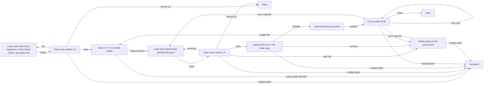

# Loop: game data import (the player's own Heroes 3 files into the app at runtime)

Structure: graph, because three producers work disjoint slices in parallel and join at one wiring
step, the new tests need a separate mutant gate, and `:app` compiles only in remote CI, so local, mutant
and CI gates are separate nodes.

## Goal and input
Let the player bring their own, legally owned Heroes 3 files into the app at runtime: check them, copy
them crash-safely into `noBackupFilesDir/gamedata/`, and show found, missing or changed status. The files
never enter the repo (Laws 1 and 9). Land the work as one pushed commit that CI builds into an APK.
Input: the branch HEAD, the advisor brief, `docs/specs/android-app.md` section 3 (3.4 lists the files),
the owner-reported usage figure. Success is the Verification section for one SHA, never a producer's
report. How the screen looks and how real files behave are NOT accepted here (they need real files and a
device); that is the owner's follow-up.

## State
File ownership (`ui/` is `android/presenter/src/main/kotlin/h3/presenter/ui/`, tests in the matching
`android/presenter/src/test/kotlin/h3/presenter/ui/`; `app/` is `android/app/src/main/kotlin/h3/app/`):
- Slice V, validator: `ui/GameDataCheck.kt`, `GameDataCheckTest.kt`. Pure. A file is present when its name
  matches case-insensitively in the chosen root or its `Data/`; size floor 92 bytes and a cap stated as a
  named constant (both literals pinned by tests); `LodArchive.open` errors map to the named codes
  `NotAnArchive`, `CorruptArchive`, `TooLargeToCheck`; `CRTRAITS.TXT` is checked in `H3bitmap.lod` with
  `contains` only; the required set is a parameter defaulting to spec 3.4 (`H3bitmap.lod`, `H3sprite.lod`,
  `H3ab_bmp.lod`, `H3ab_spr.lod`); `.pak` files only add an HD hint; every `describe()` detail carries file
  names and sizes only, never payload bytes or exception text.
- Slice P, plan: `ui/ImportPlan.kt`, `ImportPlanTest.kt`. Pure. `Data/` wins over the root;
  `AmbiguousSource` for names that differ only in case; `NotEnoughSpace(needed, free)` refuses
  `needed > free` and accepts `needed == free`; steps are copy to `gamedata.import/<name>.part`, sync and
  rename each, write `manifest.json` last, then swap `gamedata -> gamedata.old`, `gamedata.import ->
  gamedata`, delete `gamedata.old`; `recover(live, staging, old, liveManifestOk)` is total over all 8
  combinations; `status(manifest, actualSizes)` gives `Found`, `Missing` or `Changed`; progress is integer.
- Slice U, store and screen: `app/GameDataStore.kt` (java.io/nio only, no `android.*` import, all I/O on one
  thread named `gamedata-io`, runs ImportPlan steps and `recover`), `app/ImportScreen.kt` (Compose: status,
  progress, one sentence per named error plus a copyable details line, Check again, a sideload hint).
- Lead only: `app/MainActivity.kt`, `app/MenuScreens.kt` (Home Import button), `app/SpriteLoader.kt`
  (the `filesDir/gamedata` root is dropped so data lives only in `noBackupFilesDir`),
  `android/app/src/main/AndroidManifest.xml`, every Gradle file, `.github/workflows/`, `docs/specs/`,
  `docs/checkpoints/`, the trace, every commit and push. The scaffold writes stubs of the slice files with
  frozen signatures; after `verify_scaffold_local` passes, each stub belongs to its slice. A signature
  change is a report to the lead, who makes it in `wire`.
- Trace: the lead is its only writer and transcribes each actor's record. While the run is open it lives
  in `docs/checkpoints/game-data-import.trace.jsonl`; at a terminal the lead moves it to
  `docs/loops/runs/game-data-import.<run>.jsonl` in the next commit (an open trace there fails validate.py).
- Counters live in the trace (`spent`) and never go down: `ci_rounds` (pushes), `ci_infra_retries`,
  `ci_wait_minutes` and `producer_minutes` (each the longest so far), `scaffold_fixes`, `wire_fixes`,
  `rework`, the usage percent. On a save they are copied to `docs/checkpoints/HANDOFF.md`.
- Resume: the scaffold is not pushed; the lead keeps it as a patch in `docs/checkpoints/` with its
  fingerprint. Verify steps always start from a fresh clean copy; a producer rerun rewrites only its own
  files. Each push has a stable ID, the tree fingerprint F (Verification): before committing, the lead looks
  for a branch commit with fingerprint F and reuses it instead of committing.

## Actions
Allowed: slices write their own files in private copies of `git archive HEAD` plus the verified scaffold
and run the `:presenter` tests (slice U also compiles `GameDataStore.kt` in a `:presenter` scratch copy);
the lead writes the scaffold and the wiring, commits and pushes; test-verifier runs the checks and the
mutants and reads CI through the GitHub MCP actions tools.
Pushes go only to the working branch or one named feature branch (e.g. `feature/game-data-import`), and
every pushed commit is mergeable as-is: no throwaway CI branches, no WIP commits; a red CI is fixed forward
with a new commit on the same branch.
Not allowed (anyone): commit original game files, assets or fixtures cut from them (tests build synthetic
LOD bytes); a file picker, SAF or an app external drop folder (owner constraint for this loop); a new
runtime permission; change the app name (`android:label="Heroes"`, `applicationId = "h3.app"`); edit either
lint or its allowlist, `tools/skills/*.py` or `:sim` sources; merge, push to `main`, or push unverified work.

## Observation
Slice reports (claims), the lead's exit codes from the clean copy, Gradle, test-result XML and lint output,
the grep checks, the mutant table (mutant, test that failed), the fingerprint F, the CI run for the pushed
SHA (job conclusions, failing step logs, artifacts), elapsed producer minutes, CI wait minutes, the usage
figure. Failing output goes back to the slice that owns the failing file, or to `wire` when the file is
lead-owned.

## Verification
test-verifier records every `verify_*` step (role `verifier`); slices and the lead never do.

verify_scaffold_local and verify_local, in a clean copy C = `git archive HEAD` plus only the scaffold, the
slice files and the lead's files of this round (never a copy of the working tree). All must hold:
1. F = `find . -type f ! -path '*/build/*' ! -path '*/.gradle/*' ! -path './docs/checkpoints/*' ! -path './docs/loops/runs/*' -print0 | sort -z | xargs -0 sha256sum | sha256sum`,
   computed before any build and recorded.
2. `cd android && gradle --offline :sim:test :presenter:test`: BUILD SUCCESSFUL; the result XMLs for
   `GameDataCheckTest` and `ImportPlanTest` exist with `failures="0" errors="0" skipped="0"` (at the
   scaffold the stubs' placeholder tests count).
3. `GameDataStore.kt` compiles in a scratch copy of C with the file placed under `android/presenter/src/main/kotlin/h3/app/`:
   `gradle --offline :presenter:compileKotlin` BUILD SUCCESSFUL; `grep -n '^import android' app/GameDataStore.kt`
   empty; one single-thread executor named `gamedata-io`. The scratch copy is discarded.
4. `python3 tools/lint/banned_api_lint.py`, `python3 tools/lint/kotlin_banned_api_lint.py` and
   `python3 tools/lint/kotlin_banned_api_lint.py --root android/presenter/src/main/kotlin/h3/presenter/ui`:
   0 violations; both allowlists byte-identical to HEAD.
5. Ownership: every path in `diff -rq <git archive HEAD> C` is owned (State) by the writer who changed it.
6. No assets: none of those paths matches `*.def *.pcx *.lod *.pak *.snd *.vid *.h3m *.png *.bmp *.webp
   *.wav *.mp3` or lies under `android/app/src/main/assets/` or `android/app/src/main/res/`.
7. App name: the manifest still has `android:label="Heroes"` and `android/app/build.gradle.kts` still has
   `applicationId = "h3.app"`.
8. No picker: `grep -rnE 'OPEN_DOCUMENT|OpenDocumentTree|ActivityResult|getExternalFilesDir' android/app`
   empty; `grep -rn 'File(filesDir, "gamedata")' android/app` empty (verify_local only).
9. `python3 -m unittest discover -s tools/h3re/tests` OK; `python3 tools/skills/validate.py`: `0 problem(s)`;
   `python3 tools/skills/loop_eval.py graph docs/loops/game-data-import.md`: `PASS`.
A failure in a lead-owned file goes to `scaffold` or `wire`; in a slice file, to `rework`. A check that
cannot run (offline Gradle cache missing, `git archive` fails) is `cannot run`.

verify_mutants, on C after verify_local passed. Each mutant is applied alone to a fresh copy of C, then
`cd android && gradle --offline :presenter:test` must fail with a named test of the owning slice failing:
- M1 (V) the name match is exact-case.
- M2 (V) a `LodFormatError` from `LodArchive.open` is treated as OK.
- M3 (V) the 92-byte floor becomes 0 (tests pin the literals).
- M4 (P) `>` becomes `>=` in the space check.
- M5 (P) the manifest step moves before the last rename.
- M6 (V) an error detail includes the exception message (a test feeds the marker `ZZPAYLOADZZ` and asserts
  it never appears in any `describe()`).
- M7 (P) `recover` keeps staging when live is missing.
All killed is `all killed`; any survivor is `survivor` and goes to the owning slice in `rework`, unless the
verifier shows it is an equivalent mutant, which the trace records.

verify_ci, for the pushed SHA P only:
1. The `test` workflow run with `head_sha == P` (actions list tool) has jobs `android-app`, `kotlin-sim`,
   `unittest`, `determinism` all `success`.
2. That run lists the artifact `heroes-mobile-debug-apk`.
3. F computed over `git archive P` equals F from verify_local (so local and CI saw the same tree).
`infra retry` is a job that failed outside its build and test steps (runner, setup, download, upload
service); the lead reruns the failed jobs of the same run, no new commit. A compile, test or lint failure
is red; `ImportScreen.kt` compiles only here, so its red goes to slice U.

## Stop and escalation
- done: verify_ci green for P, after verify_local and verify_mutants passed with the same F. The branch is
  not merged here.
- failed: a local check cannot run in this environment; the trace carries the command and exit code.
- escalated (owner decides): a slice needs a file picker, SAF, an app external drop folder, a new runtime
  permission, an asset in the repo, or logic outside its slice; or a budget is spent (`ci_rounds`,
  `ci_infra_retries`, `ci_wait_minutes`, `scaffold_fixes`, `wire_fixes`, `rework`, `producer_minutes`,
  usage). The trace carries a `decision` evidence item naming what the owner must decide. An owner yes to a
  picker or drop folder starts the follow-up loop `game-data-picker`; it is not added to this run.
At usage 95 the lead starts no new step after the current one and writes `HANDOFF.md`; at 98 it saves and
leaves by the next `budget spent` edge. A slice at 60 minutes is stopped and its partial work is verified
as reported.

## Evidence
For one SHA P: the commit and the branch it was pushed to; F from both sides; exit codes for every local
command (Gradle test count, the two result XML counts, lint counts, unittest OK count, validate and
loop_eval output, the grep outputs); the mutant table M1-M7 with the failing test for each; the CI run id
with `head_sha == P`, the four job conclusions, the artifact name and id; the `spent` counters. Never "the
agent said it passed", and never a claim about how the screen looks or how real files behave.

## Budget
Enforced by the lead and counted in the trace. `ci_rounds` spends one per push (`commit`);
`ci_infra_retries` on each CI self-loop; `ci_wait_minutes` per round, from the push to the last of the four
jobs finishing; `scaffold_fixes` on each edge back to `scaffold`; `wire_fixes` on each edge back to `wire`;
`rework` on `rework -> dispatch`; `producer_minutes` per slice run:
- budget ci_rounds: 4
- budget ci_infra_retries: 2
- budget ci_wait_minutes: 75
- budget scaffold_fixes: 2
- budget wire_fixes: 2
- budget rework: 3
- budget producer_minutes: 60
- budget usage_wrap_up_percent: 95
- budget usage_save_percent: 98

