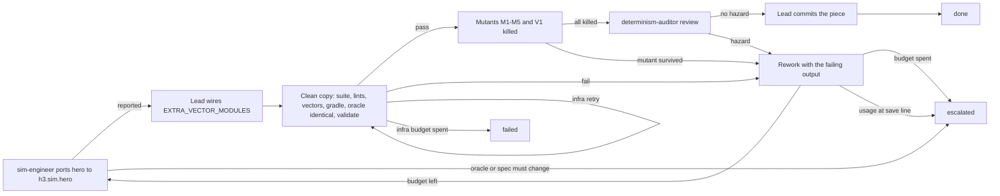

# Loop: hero port (Python hero core to Kotlin `h3.sim.hero`, with conformance vectors)

Structure: plain loop with labelled rework edges, because one producer works one bounded module with
local feedback (tests, lints, vector check); no parallel branches or joins are needed.

## Goal and input
Port the hero core (`tools/h3re/h3re/hero.py`, the oracle) to Kotlin in subpackage `h3.sim.hero`, with
conformance vectors generated from the oracle, and land it as one verified commit. Input: the PR branch
HEAD, the oracle files (`tools/h3re/h3re/hero.py`, `data/hero_test.json`, `tools/h3re/tests/test_hero.py`,
`docs/specs/hero.md`), the advisor brief, the owner-reported usage figure. Success is the Verification
section passing in a clean copy, never the producer's report.

## State
Durable outside the context window:
- Producer (role `sim-engineer`) owns these new files and nothing else:
  `tools/h3re/h3re/vectors_hero.py`, `tools/h3re/tests/test_vectors_hero.py`,
  `android/sim/src/test/resources/vectors/hero.json` (generated, never hand-edited),
  `android/sim/src/main/kotlin/h3/sim/hero/Hero.kt`,
  `android/sim/src/test/kotlin/h3/sim/hero/HeroTest.kt`,
  `android/sim/src/test/kotlin/h3/sim/hero/HeroConformanceTest.kt`, `docs/specs/conformance-hero.md`.
- Lead (orchestrating session) is the only writer of shared files: `EXTRA_VECTOR_MODULES` in
  `tools/h3re/h3re/vectors.py`, `docs/specs/conformance.md`, `docs/checkpoints/` (GRAPH, HANDOFF), the
  run trace `docs/loops/runs/hero-port.*.jsonl`, and the commit.
- Counters `rework`, `infra_retries`, `producer_minutes` and the usage figure live in the trace (`spent`)
  and, when saving, in `docs/checkpoints/HANDOFF.md`.
- Resume: a rerun of `produce` rewrites only the producer's files (idempotent); `wire` re-applies the
  same one-line `EXTRA_VECTOR_MODULES` entry; verification always starts from a fresh clean copy.

## Actions
Allowed: the producer writes its owned files and runs the Python and Kotlin tests in a private copy;
the lead wires the vector module, verifies, mutates, commits. Kotlin code lives in `h3.sim.hero` so it
does not collide with adventure's `Hero` and `IllegalCommand`.
Not allowed (anyone): touch `hero.py`, hero data, `test_hero.py` or `hero.md`; `Datapack.kt`, `Rng.kt`,
`Canonical.kt`, `Battle.kt`; either banned-API lint or its allowlists; `tools/skills/loop_eval.py`;
adventure or h3m files; re-pin any golden; hand-edit vectors; push, merge or commit unverified work.

## Observation
The producer's report (a claim), the lead's own exit codes and test counts from the clean copy, lint
output, `vectors --check` output, Gradle output, the mutation table (which mutant, which test failed),
the determinism-auditor's findings, the elapsed producer minutes and the usage figure. A failure's
output is handed back to the producer as the rework input.

## Verification
The lead accepts only from a clean copy built from `git archive HEAD` plus only the producer's files and
the lead's wiring (never a copy of the working tree).

verify_clean (lead, role `verifier`, real exit codes), all must hold:
1. `python3 -m unittest discover -s tools/h3re/tests` OK, with the hero golden
   `f18f5ebb1e249b9b4f35d707add6b89a01b19310554a723d3b048a19583022f9` unchanged in `test_hero.py`.
2. `python3 tools/lint/banned_api_lint.py` and `python3 tools/lint/kotlin_banned_api_lint.py`: 0
   violations, and no new entry in either allowlist.
3. `cd tools/h3re && python3 -m h3re.vectors --check` reports up to date, and `'hero.json' in generate()`.
4. `cd android && gradle :sim:test`: BUILD SUCCESSFUL.
5. `hero.py`, `data/hero_test.json`, `test_hero.py`, `docs/specs/hero.md` byte-identical to HEAD
   (`git diff --exit-code HEAD -- <those paths>` exit 0).
6. `python3 tools/skills/validate.py`: `0 problem(s)`.
An infrastructure fault (Gradle daemon, network, disk; not a test failure) reruns verify_clean and spends
`infra_retries`; a test or check failure goes to rework.

verify_mutation (lead, role `verifier`): each mutant, applied alone to the Kotlin port, makes the Kotlin
tests fail, and the restored code passes again:
- M1: `>=` to `>` at `primary_high_from_level`
- M2: draw the new skill before the upgrade
- M3: `r < w` to `r <= w`
- M4: drop the `xp + amount` cap
- M5: an illegal path draws from the stream before it validates
- V1: change one expected hash in `hero.json` (the conformance test must catch it)
A survivor goes to rework (add a test, or prove the mutant equivalent in `conformance-hero.md`).

verify_audit (determinism-auditor, role `verifier`): reviews the Kotlin diff for determinism hazards
(floats, clocks, unordered iteration reaching state, draws outside the passed stream). Any hazard goes to
rework.

Maker is never acceptor: `sim-engineer` records only `produce` (role `producer`); the lead records
`wire`, `rework`, `commit` (role `lead`) and the two verify steps (role `verifier`); `loop-runner`, if
used, never records role `verifier`.

## Stop and escalation
- done: verify_audit found no hazard and the lead committed the producer's files plus the wiring as one
  piece (not pushed or merged by this loop).
- failed: verify_clean could not run after `infra_retries` was spent; the trace carries the failing
  commands and exit codes.
- escalated (owner decides): the port needs `hero.py` changed or a golden re-pinned; the oracle needs new
  refusals; XP beyond level 12; offer-policy defaults; the `rework` budget is spent; usage reached the
  save line. The trace carries a `decision` evidence item naming what the owner must decide.
At usage 95 the lead stops new work after the current step and writes the handoff; at 98 it saves and
takes `usage at save line`.

## Evidence
Commit SHA (HEAD before, the new commit), exit codes and test counts for every Verification command (Python
OK count, Gradle test count), lint and `vectors --check` output, the byte-identity diff exit code, the
mutation results (mutant, failing test, restored pass), the auditor's verdict, the `spent` counters.
Never "the agent said it passed".

## Budget
Enforced by the lead, not requested of the producer; `rework` is spent on `rework -> produce`,
`infra_retries` on `verify_clean -> verify_clean`; a producer at 60 minutes is stopped and its partial
work is verified as reported:
- budget rework: 2
- budget infra_retries: 3
- budget producer_minutes: 60
- budget usage_wrap_up_percent: 95
- budget usage_save_percent: 98

